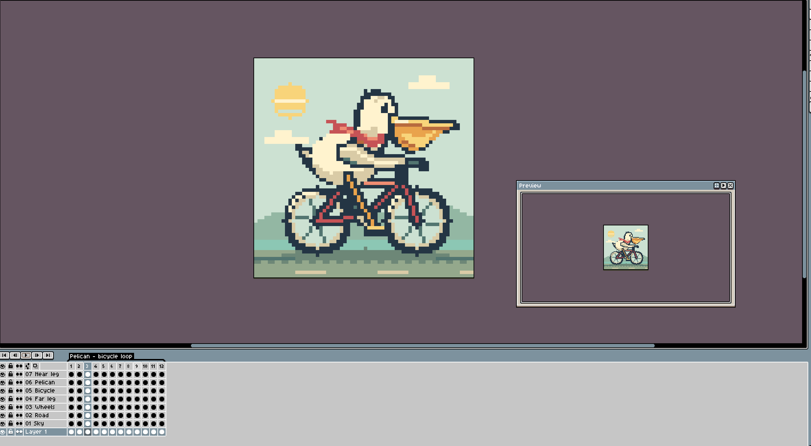
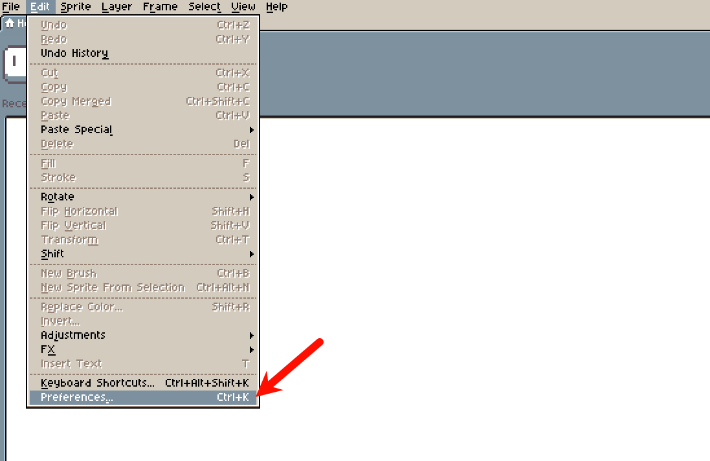
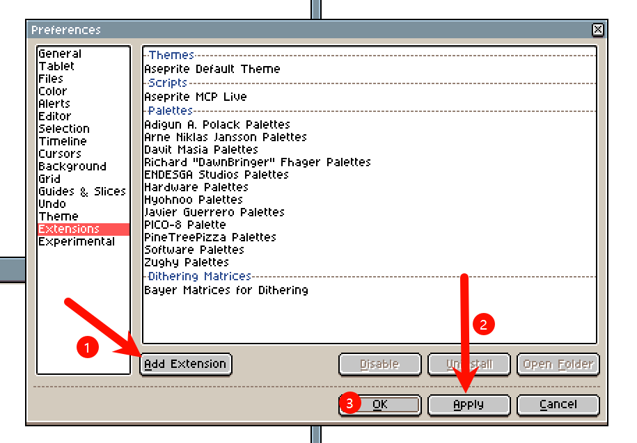
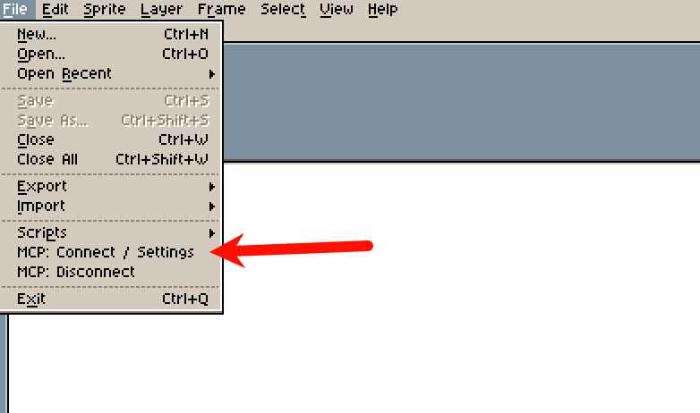
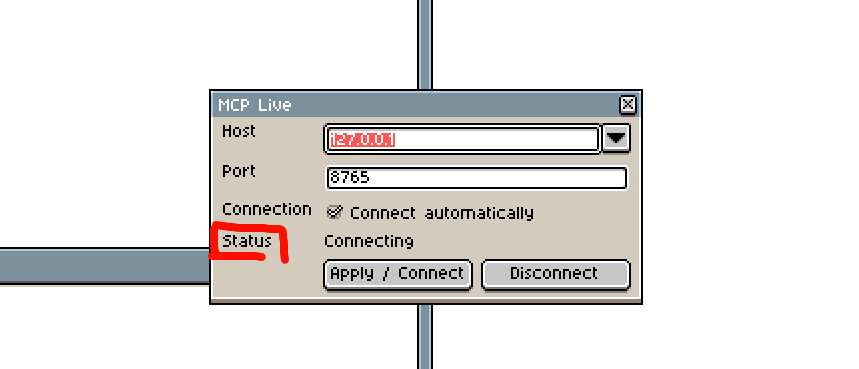
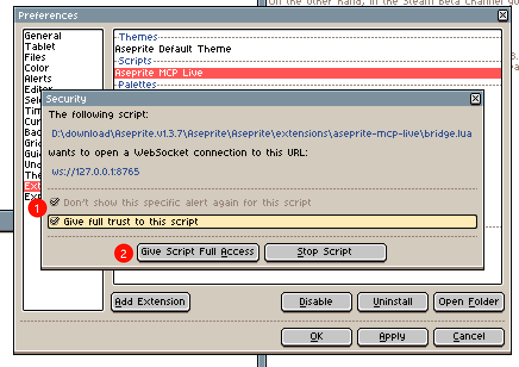
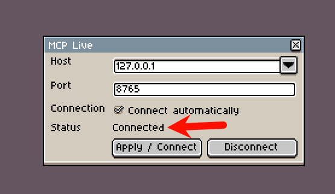

<div align="center">

# Aseprite MCP

**Make AI your pixel art collaborator**

Draw, edit, and preview pixel art in Aseprite through the Model Context Protocol.

[中文](README.md) · **English**

[](https://pypi.org/project/aseprite-mcp/)
[](https://pypi.org/project/aseprite-mcp/)
[](LICENSE)

</div>

---

Aseprite MCP connects MCP-compatible clients and agents such as `Codex`, `Claude Code`, and `DeepseekHarness` to Aseprite. Read and edit unsaved canvases, view image previews, use undo/redo, and enable basic animation to continue creating in the same document. CLI tools remain available for disk-based processing.

<div align="center">
  
</div>
<div align="center">
  
</div>

[PyPI package](https://pypi.org/project/aseprite-mcp/) · [Release extension downloads](https://github.com/greenlogs/aseprite-mcp-live/releases) · [Report an issue](https://github.com/greenlogs/aseprite-mcp-live/issues)

For **Windows + Aseprite 1.3+**. Install Aseprite separately; it is not distributed with this project.

## Quickstart

Make sure you have [installed the Aseprite extension](#install-the-aseprite-extension).
Then enter the following in your preferred AI agent:

```text
Please help me set up Aseprite MCP from https://github.com/greenlogs/aseprite-mcp-live. Aseprite is already installed at [enter the path to your aseprite.exe], and I have installed and enabled the Aseprite extension.
```

## Install uv on Windows

Run either of these options in PowerShell.

**Option 1: Official installer**

```powershell
powershell -ExecutionPolicy ByPass -c "irm https://astral.sh/uv/install.ps1 | iex"
```

**Option 2: WinGet**

```powershell
winget install --id=astral-sh.uv -e
```

Open a new terminal after installation and check that `uv` and its included `uvx` command are available:

```powershell
uv --version
uvx --version
```

Alternatively, download the archive for your Windows architecture from the [official uv releases](https://github.com/astral-sh/uv/releases), extract it, and add the executable directory to `PATH`. See the [official installation instructions](https://docs.astral.sh/uv/getting-started/installation/) for more options.

This project requires **Python 3.13+**. You can let uv manage the interpreter:

```powershell
uv python install 3.13
```

## Install the Aseprite extension

Both server options require the matching extension:

1. Visit [GitHub Releases](https://github.com/greenlogs/aseprite-mcp-live/releases) and download the `.aseprite-extension` file matching your server version. The current server version is **0.4.1**.
2. In Aseprite, open **Edit → Preferences → Extensions → Add Extension**, select the downloaded package, then install and enable it.

   
   

   Check the script status:

   
   
   

   When `status` shows Connected, the extension has successfully connected to the server.

   

3. Restart Aseprite and allow the extension's local WebSocket access when prompted.

Notes:

- 1.If the MCP connection is active but tool status fails to load, please restart the Agent client. Ensure Aseprite is launched before starting the Agent.
- 2.Please refrain from drawing on the canvas while the Agent is working to avoid conflicts during real-time collaboration.

The extension connects automatically to `127.0.0.1:8765`. Open **File → Scripts → MCP: Connect / Settings** to check its status, change the port, or disconnect. No connection file is needed.

## Option 1: Run with uvx (recommended)

Fetch and run the server from PyPI without cloning the repository:

```powershell
uvx --python 3.13 aseprite-mcp
```

This command starts a **stdio MCP server** that waits for MCP client input; a waiting terminal is normal. For regular use, let your MCP client launch the server with the configuration below. You do not need to start a second instance in a terminal.

### MCP client configuration

This example is for clients using the `mcpServers` JSON format. Other clients should use their equivalent stdio configuration.

```json
{
  "mcpServers": {
    "aseprite": {
      "command": "uvx",
      "args": ["--python", "3.13", "aseprite-mcp"],
      "env": {
        "ASEPRITE_MCP_TOOL_PROFILE": "all",
        "ASEPRITE_MCP_CAPABILITY_SETS": "animation"
      }
    }
  }
}
```

Save the configuration, restart the client, and open Aseprite. Either application can start first; the extension connects when the server is ready.

## Option 2: Build and run locally

Git is required for cloning. Alternatively, download the repository's source archive, extract it, and open its root directory.

```powershell
git clone https://github.com/greenlogs/aseprite-mcp-live.git
cd aseprite-mcp-live
uv sync --locked --python 3.13
uv run --locked python scripts/build_release.py --out-dir dist
```

The `dist/` directory contains the Python wheel, source package, `.aseprite-extension`, locked production requirements, and checksums. Install the matching extension from Releases or use the locally generated extension package.

Start the server from the repository root:

```powershell
uv run --locked aseprite-mcp
```

To let your MCP client launch the local source version, use this configuration instead:

```json
{
  "mcpServers": {
    "aseprite": {
      "command": "uv",
      "args": ["--directory", "{source-path}", "run", "--locked", "aseprite-mcp"],
      "env": {
        "ASEPRITE_MCP_TOOL_PROFILE": "all",
        "ASEPRITE_MCP_CAPABILITY_SETS": "animation"
      }
    }
  }
}
```

Replace `{source-path}` with the absolute path to your source directory, such as `C:/path/to/aseprite-mcp-live`. Choose one server configuration and run only one server per port.

## Features

| Feature                        | Description                                                                                        |
| ------------------------------ | -------------------------------------------------------------------------------------------------- |
| **Live collaboration**         | Read and edit open documents, including unsaved canvases                                           |
| **Pixels and layers**          | Create RGB canvases, add regular layers, adjust opacity, and draw pixels and rectangles in batches |
| **Visual feedback**            | Return PNG previews directly to MCP clients that support image content                             |
| **Undo and redo**              | Undo a successful editing batch in one step using Aseprite's native history                        |
| **Basic animation (optional)** | Append or delete frames, set durations, and create or manage animation tags                        |
| **CLI file tools**             | Enable disk-based processing separately using retained upstream tools                              |
| **Automatic connection**       | Wait for the server and reconnect after it restarts                                                |

The Python MCP server communicates with your client over stdio. The Lua extension connects over a local WebSocket to edit documents in Aseprite's memory. Live edits target an explicit document and revision; switching the active window does not redirect them.

## Optional configuration

### Basic animation

Add this setting to your client's `env` configuration and restart the server:

```json
{
  "ASEPRITE_MCP_CAPABILITY_SETS": "animation"
}
```

This exposes the additional `apply_animation` tool. It supports appending copies of the last frame, deleting frames, setting frame durations, and creating, updating, or deleting tags. Frames start at 1 and durations use integer milliseconds. Each animation batch supports one-step undo/redo and does not save automatically.

### Tool profiles and Aseprite path

Set `ASEPRITE_MCP_TOOL_PROFILE` to choose the available tools:

| Value                                 | Available tools                                                |
| ------------------------------------- | -------------------------------------------------------------- |
| `all` (default in the examples above) | 125 live and CLI tools combined, or 126 with animation enabled |
| `core`                                | 9 live core tools, or 10 with animation enabled                |
| `cli`                                 | 116 disk-based tools; no live connection                       |

```json
{
  "ASEPRITE_PATH": "{absolute path to your Aseprite executable}",
  "ASEPRITE_MCP_TOOL_PROFILE": "all"
}
```

### Custom port

Change the server port with a startup argument:

```powershell
uvx --python 3.13 aseprite-mcp==0.4.1 --port 8766
```

In your client configuration, append `--port` and `8766` to `args`, then set the extension's Port to `8766`. Local source execution also supports `uv run --locked aseprite-mcp --port 8766`.

## Scope and behavior

- Live drawing targets regular editable RGB layers. Unsupported edits involving non-RGB documents, locked layers, background layers, reference layers, or Tilemaps are rejected. Palettes, effects, tweening, and Tilemaps have not been migrated to live tools.
- Edits do not save automatically. Saving to `.aseprite` or `.ase` requires an explicit path; replacing an existing file requires an explicit overwrite parameter.
- Undo and redo affect the document's latest history, which may include manual edits. Large operations may exceed pixel, image-copy, or execution-time budgets; use smaller batches.
- Live tools operate on in-memory documents; CLI tools operate on disk files. A disconnected live session does not fall back to CLI. Avoid concurrent writes to the same disk file through both paths.
- The server listens only on local loopback addresses. Read the document list again after reconnecting; old session and document IDs cannot be reused.

## Troubleshooting

| Problem                               | Suggested fix                                                                                                              |
| ------------------------------------- | -------------------------------------------------------------------------------------------------------------------------- |
| `uv` or `uvx` is not found            | Reopen your terminal and client after installation, or use the executable's absolute path in the client configuration      |
| Extension is disconnected             | Check that your MCP client started the server, the extension is enabled, WebSocket access is allowed, and both ports match |
| Port is already in use                | Stop the duplicate server or change both the server and extension ports                                                    |
| Version mismatch                      | Install matching server and extension versions; use `aseprite-mcp==0.4.1` to pin the server                                |
| Missing document or revision conflict | Read the document list and information again using the current session and revision                                        |
| Preview image is not displayed        | Check MCP image support in your client and reduce the preview region or scale                                              |

For further help, open a [GitHub issue](https://github.com/greenlogs/aseprite-mcp-live/issues) with your software versions, startup method, and error message.

## Acknowledgments and license

Built on the tools and tests from [diivi/aseprite-mcp](https://github.com/diivi/aseprite-mcp), preserving its MIT license and copyright. New code is also licensed under [MIT](LICENSE).

This is a third-party integration and is not affiliated with the Aseprite team. Install Aseprite separately; it is not distributed with this project.
