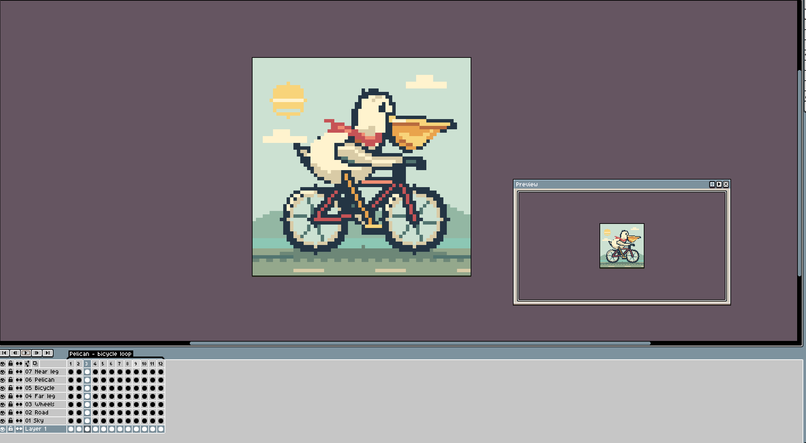
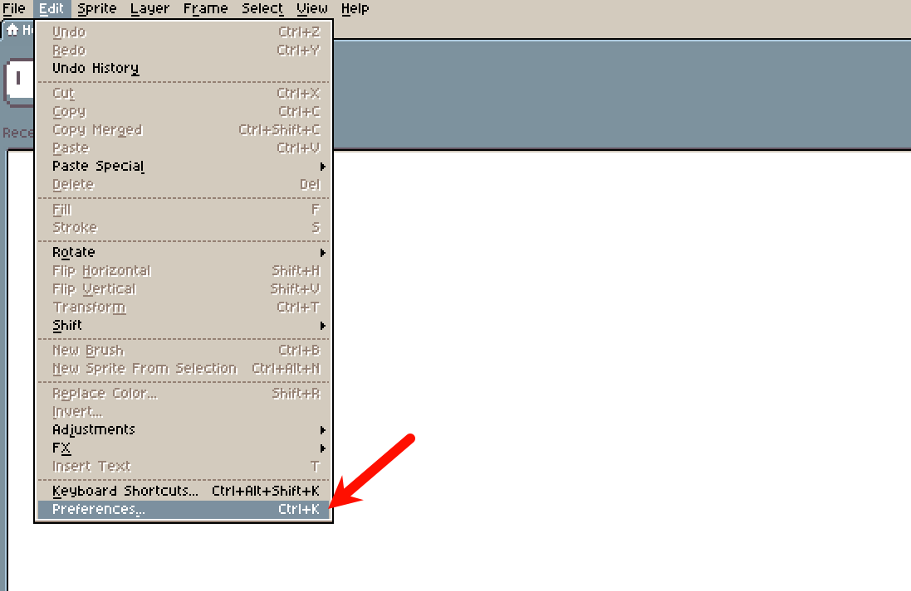
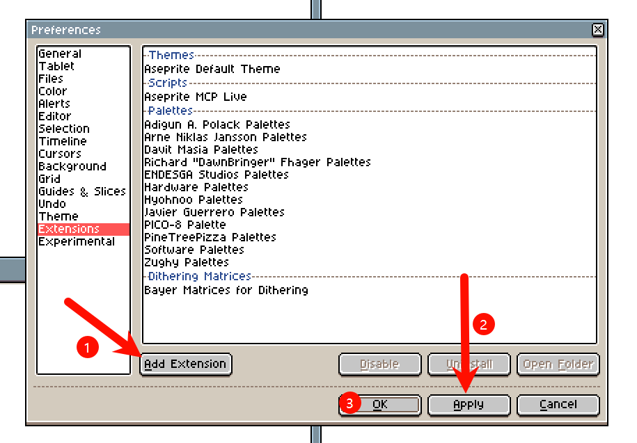
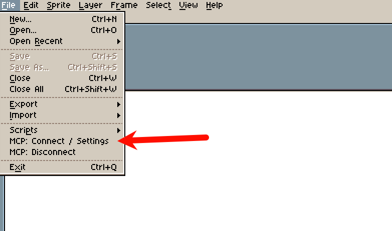
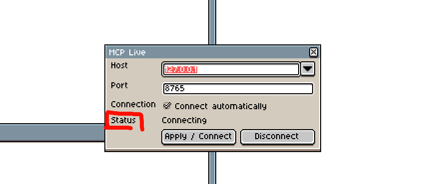
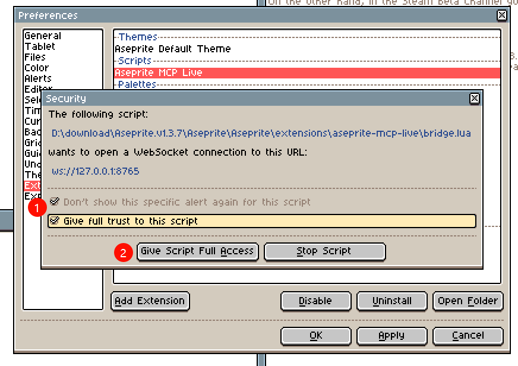
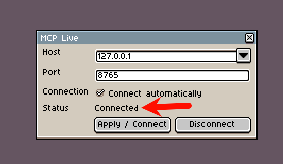

<div align="center">

# Aseprite MCP

**Make AI your pixel art creative partner**

Draw, edit, and preview pixel art in Aseprite through the Model Context Protocol.

[中文](README.md) · **English**

[](https://pypi.org/project/aseprite-mcp/)
[](https://pypi.org/project/aseprite-mcp/)
[](LICENSE)

</div>

---

Aseprite MCP connects MCP-compatible clients and agents such as `Codex`, `Claude Code`, and `DeepseekHarness` to Aseprite. It supports reading and editing unsaved canvases, image previews, undo and redo, and optional basic animation, so you can continue creating in the same document. It also retains CLI support for processing files on disk.

<div align="center">
  
</div>
<div align="center">
  
</div>

[PyPI Package](https://pypi.org/project/aseprite-mcp/) · [Extension Downloads](https://github.com/greenlogs/aseprite-mcp-live/releases) · [Report an Issue](https://github.com/greenlogs/aseprite-mcp-live/issues)

Tested with **Aseprite 1.3+ on Windows**. Aseprite must be installed separately and is not included with this project.

## Quick Start

Make sure you have [installed the Aseprite extension](#install-the-aseprite-extension).
Then enter the following prompt in your preferred AI agent tool:

```text
Please help me install Aseprite MCP from https://github.com/greenlogs/aseprite-mcp-live. Aseprite is already installed at [enter the installation path to your aseprite.exe], and I have already installed and enabled the extension.
```

## Install uv (Windows)

Run either of the following in PowerShell.

**Option 1: Official installation script**

```powershell
powershell -ExecutionPolicy ByPass -c "irm https://astral.sh/uv/install.ps1 | iex"
```

**Option 2: WinGet**

```powershell
winget install --id=astral-sh.uv -e
```

After installation, reopen your terminal and check that `uv` and the included `uvx` are available:

```powershell
uv --version
uvx --version
```

You can also download the archive for your Windows architecture from the [official uv releases](https://github.com/astral-sh/uv/releases), extract it, and add the directory containing the executables to `PATH`. For more options, see the [official uv installation guide](https://docs.astral.sh/uv/getting-started/installation/).

This project requires **Python 3.13+**. You can use uv to manage the required interpreter:

```powershell
uv python install 3.13
```

## Install the Aseprite Extension

Both server startup methods require the companion extension:

1. Go to [GitHub Releases](https://github.com/greenlogs/aseprite-mcp-live/releases) and download the `.aseprite-extension` file that matches your server version. The current server version is **0.5.1**.
2. In Aseprite, open **Edit → Preferences → Extensions → Add Extension**, select the downloaded extension package, then install and enable it.

    
    

   Check the script status:

    
    
    

   A `status` of Connected means the extension has successfully connected to the server.

    

3. Restart Aseprite. On the first connection, grant the extension permission to use the local WebSocket when prompted.

**Note:**

- Avoid drawing on the canvas while the agent is working, as this may interfere with live collaboration.

The extension automatically connects to `127.0.0.1:8765` by default. Open **File → Scripts → MCP: Connect / Settings** to check the status, change the port, or disconnect. No connection file needs to be selected.

## Option 1: Run with uvx (Recommended)

Download and run directly from PyPI without cloning the repository:

```powershell
uvx --python 3.13 aseprite-mcp
```

This command starts a **stdio MCP server** that waits for input from an MCP client. It is normal for the terminal to remain waiting. In typical use, the MCP client starts the server automatically using the configuration below, so you do not need to open another terminal to start a second instance.

### MCP Client Configuration

The following configuration applies to clients that use the `mcpServers` JSON format. For other clients, use their corresponding stdio configuration format.

```json
{
  "mcpServers": {
    "aseprite": {
      "command": "uvx",
      // Add --shared for clients that need shared mode, such as Codex with its multiple session processes.
      "args": ["--python", "3.13", "aseprite-mcp", "--shared"],
      "env": {
        // The default tool profile is core. Other available profiles are all and cli.
        "ASEPRITE_MCP_TOOL_PROFILE": "core",
        // Enable animation capabilities for the core profile.
        "ASEPRITE_MCP_CAPABILITY_SETS": "animation"
      }
    }
  }
}
```

Save the configuration and restart your client, then open Aseprite. The extension and server can be started in either order; the extension connects automatically once the server is ready.

## Option 2: Build and Run Locally

Git is required. Alternatively, download the source archive from the repository page, extract it, and open the project root directory.

```powershell
git clone https://github.com/greenlogs/aseprite-mcp-live.git
cd aseprite-mcp-live
uv sync --locked --python 3.13
uv run --locked python scripts/build_release.py --out-dir dist
```

This generates a Python wheel, a source distribution, and an `.aseprite-extension` package in `dist/`.

Start the server from the project root directory:

```powershell
uv run --locked aseprite-mcp
```

To have your MCP client start the local source version, replace the configuration with:

```json
{
  "mcpServers": {
    "aseprite": {
      "command": "uv",
      "args": ["--directory", "{source-path}", "run", "--locked", "aseprite-mcp"],
      "env": {
        "ASEPRITE_MCP_TOOL_PROFILE": "core",
        "ASEPRITE_MCP_CAPABILITY_SETS": "animation"
      }
    }
  }
}
```

Replace `source-path` with the absolute path to the source directory, such as `C:/path/to/aseprite-mcp-live`. Choose one server configuration; run only one server per port.

## Features

| Feature                        | Description                                                                                        |
| ------------------------------ | -------------------------------------------------------------------------------------------------- |
| **Live collaboration**         | Read and edit open documents, including unsaved canvases                                           |
| **Pixels and layers**          | Create RGB canvases, add regular layers, adjust opacity, and draw pixels and rectangles in batches |
| **Image feedback**             | Return previews directly as PNG images to MCP clients that support image content                   |
| **Undo and redo**              | Each successful edit batch corresponds to one undo step in Aseprite's native history               |
| **Basic animation (optional)** | Append or delete frames, set frame durations, and create and manage animation tags                 |
| **CLI file tools**             | Enable disk file processing separately and use the retained upstream tools for batch processing    |
| **Automatic connection**       | Wait for the server to become ready and reconnect automatically after it restarts                  |

The Python MCP server communicates with the client over stdio. The Lua extension connects to the server over a local WebSocket and edits documents in Aseprite's memory. Live edits are bound to a specific document and revision; switching the active window does not change the operation's target.

## Optional Configuration

### Additional Tools

For the full tool list, see the [tool reference](assets/tools.en.md).

Enable the capabilities your project needs to avoid cluttering the context. Add the following to `env` in your client configuration, then restart the server:

```json
{
  // Enable animation editing.
  "ASEPRITE_MCP_CAPABILITY_SETS": "animation"
}
```

This adds the `apply_animation` tool. It supports appending copies of the last frame, deleting frames, setting frame durations, and creating, updating, and deleting tags. Frame numbers start at 1, and durations are specified in integer milliseconds. Each batch of animation operations supports a single undo and redo step and does not save automatically.

### Tool Profiles and Aseprite Path

Use `ASEPRITE_MCP_TOOL_PROFILE` to select the tool profile:

| Value            | Available Tools                                             |
| ---------------- | ----------------------------------------------------------- |
| `all`            | 125 live and CLI tools in total; 126 with animation enabled |
| `core` (default) | 9 core live tools; 10 with animation enabled                |
| `cli`            | 116 disk file tools; does not establish a live connection   |

```json
{
  "ASEPRITE_PATH": "{absolute path to your Aseprite executable}",
  "ASEPRITE_MCP_TOOL_PROFILE": "all"
}
```

### Custom Port

Change the server port using a startup argument, for example:

```powershell
uvx --python 3.13 aseprite-mcp==0.5.1 --port 8766
```

Append `--port` and `8766` to `args` in your client configuration, and set Port to `8766` in the extension settings. When running from local source, you can also use `uv run --locked aseprite-mcp --port 8766`.

### Arguments

| Argument   | Purpose                                                                                             |
| ---------- | --------------------------------------------------------------------------------------------------- |
| `--shared` | Compatibility alias; live connections use shared mode by default in 0.5.1, so this argument is optional |

In 0.5.1, `core` and `all` use independent client proxies connected to one shared background. Closing one chat preserves the other connections. Clients must use matching tool profiles, capabilities and limits. Refresh document state after a concurrent edit causes a revision conflict. The `cli` profile continues to provide disk tools without a live connection.

When upgrading, install the matching 0.5.1 extension and restart your MCP client, ensuring the previous background has exited. Remove the obsolete `--takeover` and `--no-takeover` arguments from existing configurations. The service does not terminate processes occupying the port.

## Scope and Limitations

- Live drawing supports regular, editable RGB layers. Unsupported edits involving non-RGB documents, locked layers, background layers, reference layers, or tilemaps are explicitly rejected. Palettes, effects, tweening, and tilemaps have not yet been migrated to live capabilities.
- Edits are not saved automatically. Saving as `.aseprite` or `.ase` requires an explicit path, and overwriting an existing file requires an explicit overwrite parameter.
- Undo and redo apply to the document's latest history and may also affect manual edits. Larger operations may hit pixel, copy, or execution time limits; reduce the batch size if this happens.
- The live backend operates on documents in memory, while the CLI backend operates on files on disk. A disconnection does not trigger an automatic switch to CLI. Avoid writing to the same disk file through both backends at the same time.
- The server listens only on the local loopback address. After reconnecting, read the document list again; old session and document IDs cannot be reused.

## Troubleshooting

| Issue                                   | Resolution                                                                                                                                                       |
| --------------------------------------- | ---------------------------------------------------------------------------------------------------------------------------------------------------------------- |
| `uv` or `uvx` not found                 | Reopen your terminal and client after installation, or use the executable's absolute path in the client configuration                                            |
| Extension not connected                 | Confirm that the MCP client has started the server, the extension is enabled, WebSocket permission has been granted, and both sides use the same port            |
| Port already in use                     | The current source version shares connections by default. If an older standalone server or another program is using the port, stop it or choose a different port |
| `Transport closed`                      | The previous MCP channel has ended. Enable shared mode and reestablish the client connection; restart the client if necessary                                    |
| Version mismatch                        | Install matching versions of the server and extension. Use `aseprite-mcp==0.5.1` to pin the version                                                              |
| Document not found or revision conflict | Read the document list and information again, then use the current session and revision                                                                          |
| Preview image not displayed             | Confirm that the client supports MCP image content, and reduce the preview area or scale factor                                                                  |

If the problem persists, submit your software versions, startup method, and error message through [GitHub Issues](https://github.com/greenlogs/aseprite-mcp-live/issues).

## Acknowledgments and License

Adapted from the tools and test foundation of [diivi/aseprite-mcp](https://github.com/diivi/aseprite-mcp). The upstream MIT license and copyright notices are retained, and new code is also released under the [MIT License](LICENSE).

This project is a third-party integration and is not affiliated with the official Aseprite project. Aseprite must be obtained separately and is not distributed with this project.

## Source drawing additions (0.6.0, unreleased)

Batches reuse Cel images and add bulk pixels, region writes, lines, ellipses, region clearing, and `read_pixels`. Region reads/writes support RGBA and RLE; writes support replacement and source-over compositing. See the [drawing reference](DRAWING.md) (Chinese). Source profiles expose 10 core / 126 all tools, plus one when animation is enabled. Matching 0.6.0 service and extension are required; published 0.5.1 does not include these additions.
