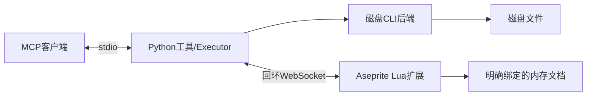

# 架构与接口边界

当前版本0.3.0；Windows Aseprite1.3.7/API28基线。采用Python3.13+、uv、MCP stdio与Lua扩展；上游来源和许可见[THIRD_PARTY](../THIRD_PARTY.md)。P2-M4用户更正要求明确：连接不能依赖JSON文件，且扩展不能提供选文件入口。

## 依赖与职责

工具层负责参数和TextContent/ImageContent；protocol定义操作/结果/错误/预算，execution负责显式路由、会话、资源队列、去重与取消后的确认。CLI负责进程/回执/文件摘要及同卷原子替换；live只负责本机传输和请求关联，文档/图层注册、修订、上下文、事务和预览在扩展执行。实际目录和入口唯一来源为[PROJECT_STRUCTURE](../PROJECT_STRUCTURE.md)。

实时失败不得自动切换CLI。默认core为9项实时入口；cli保留115项原名工具+cli_execute，all125项；原始Lua须显式CLI开关，不进入实时核心。旧工具通过worker保持异步服务响应和共享路径锁，但不因此获得公共CLI的nonce/文件摘要事务保障，P3按清单迁移。

## 无文件本机连接

默认Python监听127.0.0.1:8765，CLI --host/--port优先于环境与默认；localhost映射IPv4回环，端口1–65535，只允许回环地址。Aseprite官方WebSocket为客户端，因此扩展主动直连；不能照搬Blender Python插件监听方向，但用户体验同为固定端点、打开即连接。服务和编辑器启动顺序不限。

不生成、读取、清理发现JSON，不使用运行目录、token、注册表或其他隐式配对文件。ASEPRITE_MCP_CONNECTION_FILE/RUNTIME_DIR不再读取；旧文件原地保留。扩展设置仅Host、Port、自动连接和手动断开，没有Legacy JSON或选文件入口。编辑器自身按官方plugin.preferences保存偏好，不承担凭据发现。

无共享密钥认证；回环和Origin限制不能证明本机程序身份。仅接受无Origin或目标ws://Origin（API28 ixwebsocket实际发送），普通http/https/nullOrigin拒绝；不提供远程连接或加密。版本/单会话校验服务于兼容与目标一致性。用户通过Disconnect可停用连接。

扩展延迟启动1秒Timer，仅根据地址/端口创建socket。每个OPEN重新分配session并重建文档注册，旧ID失效。为处理API28强杀后半开socket，传输层有ping/pong心跳，5秒无回应淘汰socket，再由Timer重建；CLOSE/ERROR也释放旧socket。用户停止持久关闭自动连接，卸载/重载清理定时器、socket、事件和对话框；不后台启动外部服务，不探测其他端口或自动切换编辑器。

## 目标与事务

实时对象按会话注册的不透明ID定位，不按名称或activeSprite隐式选择。内容事件推进revision，活动图层/帧/选区/命令推进context_revision；执行前核对显式目标和预期修订/上下文。关闭/删除对象失效，临时切目标的操作在回调中恢复原活动上下文。

core编辑仅普通RGB图层：create_layer/set_opacity/pixel/rectangle。批次先整体校验，再进入单次app.transaction；Cel图像副本赋回支持撤销，失败整批回滚。累计绘制/图像副本预算与0.25秒CPU预算，超限拒绝/回滚，不拆多次提交；一个成功批次一次撤销。保存/导出/任意Lua不进入事务。undo/redo作用于指定文档最新历史，包括人工编辑。

保存只允许显式原生.aseprite/.ase绝对路径，已有目标overwrite=true；未调用不隐式保存。preview在独立Image合成指定帧/区域，内存PNG/base64编码，MCP返回原生图片及文字元数据，不修改源文档/历史，不以本地路径代替图片。

## 可靠性与磁盘边界

按实时会话/规范化磁盘路径排队，不同文件不互阻塞。调用方取消仅取消等待，受shield保护的已接收任务继续确认；执行中同ID同摘要合并，不同内容冲突。缓存有TTL/容量，断开只清实时缓存，CLI回执跨重连保留。写入发送后断线/超时为RESULT_UNKNOWN，不自动重发；迟到回执丢弃，调用者先刷新状态再决策。

CLI公共路径只支持info/apply；固定Lua通过JSON业务参数临时文件执行（这与已移除的连接配置文件无关），随机nonce校验回执和新产物，文件摘要比较后原子替换。expected_file_revision支持读取到修改的冲突检查；最终比较与替换仍有外部写入短竞态，不提供强制跨进程锁。旧高级工具独占目标使用，不能与实时保存并发覆盖。

CLI/旧MCP工具在线程运行，共享有限期路径锁；subprocess.run超时终止并等待本次进程，临时资源清理，Windows输出在调用线程严格UTF8解码。SDK1.6.0的ToolError前缀由ContractServer兼容边界解包为JSON Result/isError一致；升级SDK需复测。

## 版本与分发

业务Request/Result保持v1；0.3.0 hello移除token，旧扩展须配套升级。公开字段、预算与兼容见[PROTOCOL](PROTOCOL.md)。历史P0/P1及0.1/0.2连接方案只记录在交接，不是当前架构。

hatch构建服务wheel/资源，sdist白名单；构建器核对服务/扩展清单/Lua握手版本，生成扩展ZIP、锁定生产依赖和摘要，不分发Aseprite/配置/会话。CI只跑无软件契约/文档/构建，真实UI及安装客户端显示单独验收；不自动推送或发布。
