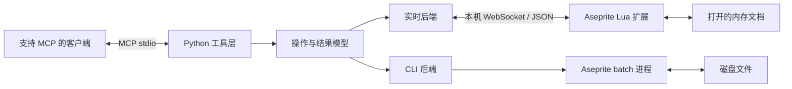

# 架构与接口边界

状态：P0 已建立上游 CLI 基线、严格协议类型、公共执行接口和工具暴露配置。P1-M1 已实现并真实验证 WebSocket 传输及 Lua 扩展生命周期；文档/事务和 PNG 图片反馈已在 P1 全部真实验收。固定类型、默认值、线格式及可校验样例见 [协议 v1](PROTOCOL.md)。

## 架构与职责

- MCP 工具层负责参数、能力暴露、结构化结果和图片内容，不内嵌加载文件、保存文件的策略。
- 实时后端负责会话、请求关联及转发；Lua 扩展主动连接 Python 本机服务，负责对象查找、UI 线程内执行和文档事件。
- CLI 后端复用上游批处理能力，负责进程生命周期、磁盘输入输出、超时和脚本结果解析。
- 共同的操作语义供两个后端实现，但能力可不同；不支持时返回明确结果，不假装兼容全部工具。
- 默认面向本机单编辑器连接；多实例连接不自动选择目标，首版明确拒绝额外活动会话。多编辑器协作为后续需求重新设计。

首版 MCP 客户端传输沿用上游 stdio；内部 WebSocket 不充当 MCP 传输。Streamable HTTP、远程编辑器和自动生成美术内容均非首版要求。

## 首版工具与操作边界

以下实时核心工具名称已在 P0 注册，P1 已全部接通（无连接时内容操作仍返回 NOT_CONNECTED）；上游现有 CLI 工具保留原名，使用单独能力集，避免同名改变原有文件语义。

| 工具 | 目标行为 |
|---|---|
| `get_connection_status` | 返回连接状态、会话、Aseprite/API 版本及已协商能力 |
| `list_documents` | 列出当前打开文档及会话内标识，区分活动文档和未保存文档 |
| `get_document_info` | 读取指定文档的尺寸、色彩模式、图层、帧、活动状态和修订信息 |
| `create_sprite` | 创建指定尺寸的 RGB 文档并返回标识，不隐式保存 |
| `apply_operations` | 对指定文档执行经检查的一批操作，事务提交后返回新修订信息 |
| `get_preview` | 返回指定文档/帧或区域的 PNG 图片及修订、帧号和缩放信息 |
| `save_sprite` | 显式保存指定文档；未命名文档要求目标路径，覆盖须显式允许 |
| `undo`、`redo` | 对指定文档执行撤销或重做，返回实际修订信息 |

首版 `apply_operations` 只支持创建普通图层、设置图层不透明度、在显式图层和帧绘制像素及矩形；矩形支持实心/描边。绘制目标默认为 RGB 普通图层，首版不支持索引/灰度绘制、参考图层、Tilemap 或任意 Lua 执行，返回能力不支持结果。文档读取和预览按实际可探测能力提供。

像素坐标使用画布坐标，帧号从 1 开始，颜色使用 RGBA 整数分量 0–255。缩放使用整数最近邻；图层操作通过会话内标识定位，不依赖名称唯一。新建图层结果提供标识；同一批次如需引用新图层，使用批次内引用，已冻结为 `{kind: "ref", value: "批次引用"}`；真实标识使用 `{kind: "id", value: "图层标识"}`。

## 目标、版本与消息

P0-M2 已冻结可执行契约及[样例](protocol-v1.examples.json)，见 `core/protocol.py`、`core/execution.py` 和 [协议 v1](PROTOCOL.md)：

- 连接握手包含协议版本、软件版本、API 版本、能力及会话标识。协议版本不兼容拒绝连接；新会话不复用旧对象标识。
- 请求包含唯一请求标识、明确的会话及文档目标、操作与参数；内容相关的编辑和预览附预期修订。文档列表及新建操作不要求尚不存在的文档目标。
- 统一结果区分成功、数据、错误码及可读说明，携带实际目标和修订；MCP 工具失败使用协议支持的错误标记，不仅返回一段看似正常的文字。
- 不连接、会话失效、文档关闭、修订冲突、不支持能力、参数错误、执行失败、超时和执行结果未知分别可识别。
- 活动上下文与文档修订均需验证：请求不因用户切换文档而指向新的活动文档；可安全显式定位的请求继续操作原目标，依赖已失效活动状态的操作返回冲突。

图层标识由扩展会话注册表管理，删除后失效，重名和重命名不改变定位语义；不依赖本地版本尚无的持久 UUID。监听器维护文档内容修订，覆盖人工编辑、撤销和重做；活动图层、帧、选区信息单独维护上下文，避免把元数据变化误当作同一对象。

## 事务、保存与反馈

同一文档操作在扩展中串行处理，在执行前再次核对目标与修订。批量编辑先检查所有操作，再进入 `app.transaction()`；图像使用副本修改并赋回 `cel.image` 等能进入撤销栈的路径，不把直接 `drawPixel/putPixel` 视为已有撤销信息。

一个成功批次对应一次撤销；任一支持的编辑失败时整个编辑事务回滚。批次不包含文件保存、导出、网络或任意脚本操作，事务不承诺回滚外部副作用。新建文档、保存和撤销/重做是独立工具。

保存与编辑分离。CLI 兼容工具可保持原有显式文件修改语义；不得直接将其内嵌 `saveAs()` 搬进实时编辑。临时切换活动目标、选区和帧的命令需在成功或失败后恢复可恢复上下文；不支持恢复的命令不进入首版工具集。

预览从指定修订和帧生成，不修改源文档或保存状态；图片通过 MCP 图片内容直接返回。临时文件由后端管理并清理，不以返回本地路径替代模型可见的图像。客户端是否显示图片须真实验证。

## 执行与兼容约束

WebSocket 服务绑定回环地址并采用每次启动会话校验；扩展提供连接/断开菜单，退出时清理连接与监听器。版本能力探测需兼容 Aseprite 1.3.7，WebSocket 回调不依赖新版才有的错误参数。

UI 回调不执行无界循环；限制单请求操作数和像素数量，当前上限为 256 操作、262144 像素，见协议 Limits；P2 用实测调整。首版超限明确拒绝，不把一个原子批次悄悄拆成多次提交。长分析任务可在后续能力中定义分段语义。

请求超时不代表操作没有发生。已接收请求在会话内去重，重试相同标识不重复绘制；连接中断时未确认的变更返回结果未知，刷新文档状态后再继续，不盲目重发变更。

CLI 采用异步进程或受控线程，不阻塞 MCP 事件循环；设置超时并清理本次启动的子进程。输出使用结构化脚本封装及明确成功标志，不能只依据退出码 0 或旧文件已存在判定成功。

默认工具暴露实时核心能力集，保留可配置的上游 CLI 能力集；高级工具经兼容清单和回归后再启用。原始 Lua 入口沿用上游时仅属于显式开启的 CLI 高级能力，不作为核心编辑实现的外部接口。

## P0 实际执行路径与兼容

`server.create_server()` 默认 core 配置注册 9 个入口；cli 配置保留 115 个原名兼容工具并新增 `cli_execute`，all 合并为 125 个。原始 Lua 只有 `ASEPRITE_MCP_ENABLE_RAW_LUA=1` 且启用 CLI 配置才额外开放。上游装饰器注册对象仍保留 116 项以复用基线，但不是默认服务的暴露集合。

公共执行：工具/调用方 → Request 严格校验 → Executor 显式路由 → CliBackend / LiveBackend → Result。CLI 最小纵向路径支持文档读取及四种批量操作，Lua 固定脚本读取 JSON 参数；同卷临时产物、匹配 nonce 回执、文件头及源摘要检查后才替换源文件。旧兼容工具仍调用原 commands 接口，没有一次性重写所有算法。CLI 图层索引路径只在当前文件树有效；实时对象保持会话注册标识，两者不可互换。

内部端点配置只允许回环；启动 token 每次随机生成。P1-M1 已用 FastMCP lifespan 启动 listener，连接绑定同一 Executor。P1 已实现同一 Executor 绑定、编辑端去重、修订及上下文检查；P0 的模拟测试不能代替这些真实能力。

## P1-M1 连接实现

服务以每进程临时 JSON 文件公布回环 url 和随机 token（独占创建/退出清理）；stderr 仅报告路径，状态工具返回路径、端点和软件版本，不含 token。可用 ASEPRITE_MCP_CONNECTION_FILE 指定文件；CLI profile 不监听。扩展设置选择此文件，保存路径，手动连接；重连重新分配 session，断开清理等待项。API 28 JSON userdata 在接收边界递归转表，避免嵌套编码变 null。

## P1-M2 文档实现

editor.lua 以对象相等比较维护注册表，sync 时剔除关闭/删除项，编号不复用。change 和属性事件推进内容修订，sitechange 推进独立上下文；修订是事件计数，不能假定每批恰好 +1。with_target 仅在 UI 回调内部临时切换，抑制自身上下文事件并恢复活动对象。像素副本边界保留原 Cel 及新绘制区域的并集，保留画布外像素且限制分配。保存仅允许原生 .aseprite/.ase 绝对路径，避免文件格式导致信息丢失；覆盖需要显式允许。

## P1-M3 图片与上下文

preview.lua 用独立 RGB Image.drawSprite 合成帧/区域，在内存中生成 RGBA PNG（存储型 deflate、CRC32、Adler32），不产生磁盘中间文件或改动源文档。整数最近邻复制，先检查像素/预计 PNG 大小，再检查编码和消息预算。server 校验 PngPayload 后返回文字元数据和原生 MCP 图片内容，文字不重复 base64。

上下文由 sitechange、aftercommand 及请求前活动对象/帧/选区边界检查维护；aftercommand 保守推进上下文，涵盖边界不变的选区形状命令，自身临时目标切换/历史命令抑制这些上下文事件。内容修订仍由文档事件独立维护。

正常 lifespan 清理发现文件；Windows MCP SDK 1.6.0 客户端采用强制终止，可能不触发 finally 而留下发现文件。默认发现路径每进程独立；固定路径重启前应确认旧服务已退出并移除残留。P2 将系统复核异常退出和发现策略；不据正常退出测试宣称强杀也能清理。

## P2-M1 可靠性决策

Executor 使用按会话/磁盘路径的独立队列与受 shield 保护的任务，取消调用方只取消等待；执行中去重和最终缓存共用 ID/摘要规则。旧会话完成不污染新缓存，迟到确认丢弃；未知写入先读状态后决策。CLI 和旧 MCP 工具共享有限期线程磁盘锁，旧函数在 worker 内运行；高级旧工具的原子性与文件摘要不因此获得升级。

CLI 公共 Request 新增可选 expected_file_revision，data.file_revision 为 SHA-256；执行前和提交前比较，保留不传字段的兼容。仍不提供外部进程的文件锁。实时 Cel 副本面积累计上限和 0.25 秒事务 CPU 预算保护 UI，预算失败整批回滚。协议/错误/取消细节见 PROTOCOL 的 P2 补充。默认发现路径追加 UUID；固定路径残留由使用者确认旧服务退出后处理。

## P2-M2 分发与版本

hatch wheel 只包含服务包/资源，sdist 使用显式白名单。scripts/build_release.py 从同一工作区建立服务包、根部 manifest 的扩展 ZIP、锁定生产依赖与摘要；scripts/verify_install.py 不导入开发源码，从独立 site-packages 和新扩展配置执行真实 MCP 验收。默认用户入口为安装环境 aseprite-mcp 可执行脚本；独立 python -I -m 入口同样可用。

服务/扩展 0.1.0、协议 v1；扩展上报可选 extension_version 并校验已提供的版本。ContractServer 封装 SDK 1.6.0 错误包装兼容点，保留 JSON Result 与 MCP isError 的一致性。CI 只覆盖无 Aseprite 契约、文档与分发检查，真实 Windows GUI 验收单独记录，不包含远程发布动作。

## P2-M3 自动连接决策（替代旧默认发现流程）

0.2.0 保留 Python listener / Aseprite WebSocket 客户端方向，默认固定 127.0.0.1:8765；--host/--port 优先于环境和默认。Aseprite 官方 API 是客户端，不能照搬 Blender Python 插件的 socket 监听方向；采用相同的“固定端点、自动启动/连接”用户体验。

服务先绑定端口，再向用户运行目录按 host/port 原子发布本次随机凭据。默认路径可在成功独占端点后替换强杀残留；显式 CONNECTION_FILE 仍独占创建。扩展启用后延迟 1 秒自动读取此文件，服务重启时检测凭据变化并建立新会话；认证和旧请求隔离保留。Timer 在手动停止/卸载时释放，Disconnect 持久停用自动连接。高级 Legacy JSON 保留旧方式，不再是正常路径。公开文档中的旧随机文件/手选流程由本节替代。

运行目录：ASEPRITE_MCP_RUNTIME_DIR（绝对路径）或第一个非空 LOCALAPPDATA/XDG_RUNTIME_DIR/TMPDIR/TEMP 加 aseprite-mcp，无环境时 /tmp/aseprite-mcp；Python/Lua 使用一致规则。每端点 connection-<host冒号替换为下划线>-<port>.json。多进程需显式不同端口；没有自动端口扫描、目标漂移或 CLI 降级。仅 Windows 基线声明真实验收。
